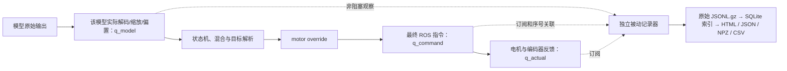

# ELF3 模型输出—执行评测

独立的 29 自由度评测项目。核心只依赖 Python 3.10+ 和 NumPy；离线分析不导入 ROS，不连接机器人，不需要 SONIC、相机、PICO、SMPL 或训练环境。

当前版本 0.2.0 已完成：旧 SONIC 真机记录回放、NormalMotionPolicyMjlab 真实 ONNX 的离线推理与转换核对、合成误差/延迟测试、本地被动记录器测试，以及可选 SONIC `g1_kin` 重建参考比较。**新记录器和观察点尚未在机器人安装或验收。**

## 测什么

- 主结果 `q_actual - q_model`：模型按自身真实规则转换后的物理角，与编码器反馈之差。
- 辅助结果 `q_actual - q_command`、`q_command - q_model`：区分框架处理与执行跟随。
- 原始数据、对齐数组使用 rad；统计和图使用度。
- 没有模型目标时，明确显示“模型输出未观测”，仍可计算指令误差。
- 只使用按名称匹配的身体29关节；31维消息中的头部会保留在原始记录中，评分时排除。
- 保持、混合、模型切换、时钟异常、缺失关节、陈旧目标、未知使能状态均单列。没有数据不填零。
- 这是关节编码器跟随度量，不是外部动捕或绝对空间精度；不预设精度达标阈值。



## 安装和离线运行

在本项目根目录执行，使用 uv/venv，无需 conda：

```bash
uv venv --python /usr/bin/python3 .venv
uv pip install --python .venv/bin/python -e .
.venv/bin/elf3-eval check
.venv/bin/python -m unittest discover -s tests -v
```

ROS 主机如果必须使用系统安装的 rclpy，则创建 `uv venv --python /usr/bin/python3 --system-site-packages .venv`，并先 source 现场实际 ROS/工作区环境。系统 Python 必须与 ROS 构建版本匹配。不要复用已经删除的 conda 路径。

本次开发环境为避免联网安装，使用 system-site-packages venv，借用已有 NumPy 1.26.4，再以 `uv pip install --no-build-isolation --no-deps -e .` 安装本项目。可通过 `UV_CACHE_DIR` 指向工作目录缓存；这不改变正常部署命令。

```bash
# 输入为原始旧记录目录、JSONL 或 JSONL.gz；永不修改原文件
elf3-eval import /path/to/run --output /path/to/new-run.sqlite
elf3-eval analyze /path/to/new-run.sqlite --output /path/to/new-report

# 明确指定数据新鲜度规则；只是示例，并非统一推荐阈值
elf3-eval analyze /path/to/new-run.sqlite --output /path/to/selected-report \
  --model MODEL_ID --start 100.0 --end 110.0 \
  --command-age-ms 80 --model-age-ms 80 --feedback-gap-ms 10
```

分析目录必须为空，避免误覆盖结果。时间筛选值是记录中的单调秒。默认上限从每个时钟段的实际周期估计：指令/模型各3倍中位周期，反馈连续性5倍中位周期；这是可更改的新鲜度启发式，不是电机规格。规则会写入报告。不同规则的结果不可直接混为同一验收结果。

## SONIC 重建参考比较（可选）

增加第四条曲线 `q_ref`，并报告 `q_actual - q_ref`、`q_model - q_ref`、`q_command - q_ref`。复用旧 SONIC 工具的 g1_kin 输出拆解与 FSQ token 检查；独立库不导入旧工具代码，也不在记录端运行参考推理。

```bash
uv pip install --python .venv/bin/python -e '.[sonic-reference]'

# 先用新版重新导入：0.1 的 SQLite 索引没有保存 token；原始记录无需重录
elf3-eval import /path/to/sonic-run --output /path/to/sonic-v02.sqlite
elf3-eval analyze /path/to/sonic-v02.sqlite --output /path/to/sonic-report \
  --sonic-reference /path/to/reference-bundle
```

`reference-bundle` 是独立资产目录，包含旧工具已验证的 `kinematic_manifest.json` 和 `g1_kin_step28800.onnx`；可以直接指向旧工具的 `evaluation/`，也可以只复制这两个文件到任意目录。模型资产不作为 Python 包依赖，普通三曲线评测不需要它们或 ONNX Runtime。

软件校验 ONNX 文件指纹、兼容控制模型指纹、29关节名称、弧度单位和输出打包约定。只取对应推理的当前参考帧，不乘 action_scale、不加默认姿态、不拿未来帧配对。缺 trace/token、模型不匹配、保持/混合、非 live_reference 等情况单列原因；原有三组比较继续保留。重新导入只能恢复原始记录中已有的 token，只有 command/state 的记录不能凭空恢复参考。

`q_ref` 是学习模型的重建结果，不是独立真值。模型目标相对参考的偏差也不自动等于控制错误。详见 [SONIC 参考说明](docs/SONIC_REFERENCE.md)。

## 被动记录

以下命令留给现场窗口，由操作者在已确认的实际运行环境中执行：

```bash
elf3-eval check --ros
elf3-eval record --output /path/to/new-run --seconds 60

# 利用已存在的 SONIC STK1 观察点，附加监听，不安装/改写 SONIC
elf3-eval record --legacy-sonic --output /path/to/new-sonic-run --seconds 60

# 仅本机 socket，用于无 ROS、无电机集成测试
elf3-eval record --socket-only --address my_eval_socket --output /path/to/socket-run --seconds 10
```

硬件话题可通过 `--state-topic`、`--command-topic`、`--mode-topic` 配置；socket 名称用 `--address`。没有硬编码 SSH/IP/用户/工作区。记录器仅订阅与接收，不发布控制命令，不使能，不切状态。已有记录器占用观察 socket 时直接报错，不停止对方。

记录用有界队列（4096项）、非阻塞投递、独立写盘线程、gzip level 1；队列溢出计数。关闭只作用于本记录器。退出码0表示该命令执行完成，**不代表模型可观测或精度达标**；记录端退出码3表示丢样、写盘/回调问题或空记录；2表示输入/环境错误。数据质量以 JSON 报告为准。

## 输出

| 文件 | 内容 |
|---|---|
| `events.jsonl.gz` | 完整新记录，含原始话题数组和时间；不会因评分过滤而删数据 |
| `metadata.json` / `capture_result.json` | 主机、时钟、话题、队列/写盘计数，零控制发布声明 |
| `*.sqlite` | 流式导入的派生索引；原记录路径和解压后 SHA256 可追溯 |
| `report.html` | 自包含、无需网络；选择模型/段、关节、时间窗，对照三条曲线；启用SONIC参考后四条 |
| `report.json` | 每段、每关节/部位误差、覆盖、滞后、阈值和排除原因 |
| `metrics.csv` | 小型指标汇总，不默认展开1000Hz全部关节样本 |
| `sonic_reference.npz` | 仅在启用参考时生成；每次推理完整10帧参考角/速度、朝向、身份与不可用原因 |
| `aligned.npz` | 全分辨率弧度数组、有效掩码、目标年龄、时间和阶段 |

HTML 时间窗只改变浏览范围，表格是整段统计。重新统计某个范围请用 CLI `--start/--end`。曲线最多每段1600点，JSON统计使用全量样本。`aligned.npz` 的键为 `s0_t`、`s0_q_model`、`s0_q_command`、`s0_q_actual`、`s0_valid_model` 等，可用 `numpy.load(..., allow_pickle=False)` 读取。启用参考后增加 `s0_q_ref`、`s0_valid_reference`、`s0_reference_age_s` 和 `s0_reference_reason`。

分析按时钟段加载数据到内存，已验证120秒/约12万反馈规模；目前不是无限时长流式统计器。长记录应分次录制。原始记录始终流式写盘，不因记录时长扩展内存队列。

## 接入与验证说明

- [接口核查与事件合同](docs/INTERFACES.md)
- [现场人工部署与验收](docs/DEPLOYMENT.md)
- [离线验证范围与复现](docs/VALIDATION.md)
- [复用来源](PROVENANCE.json)
- [未应用的最小补丁](patches/underlay-normal-observer.patch)

`tools/validate_normal_onnx.py` 可选依赖 onnxruntime，只用于开发验证，不是核心依赖。`tools/benchmark_observer.py` 用合成数据做本机 socket 测试。Unix socket 测试需要允许 AF_UNIX；受限沙箱拒绝 bind 不代表记录器失败。
